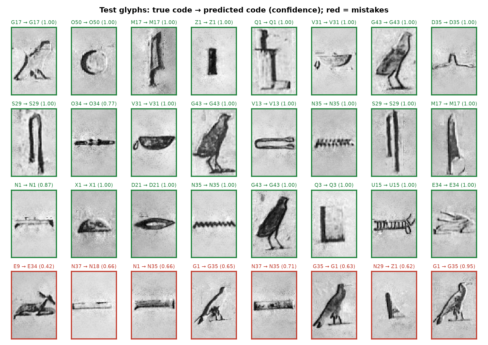
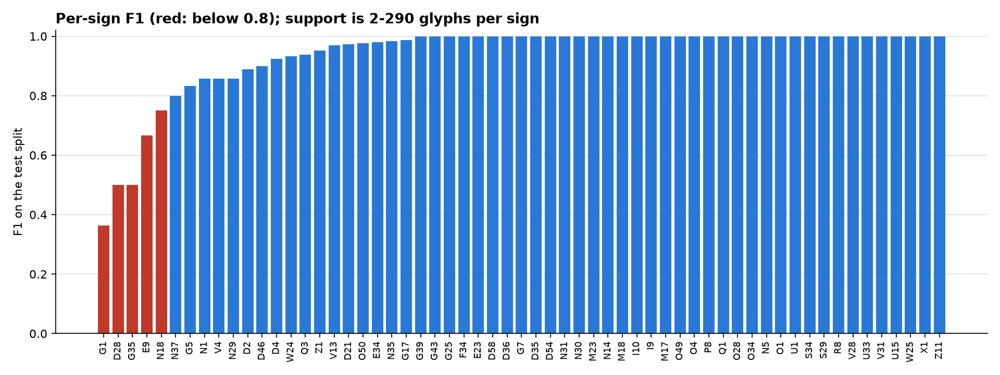
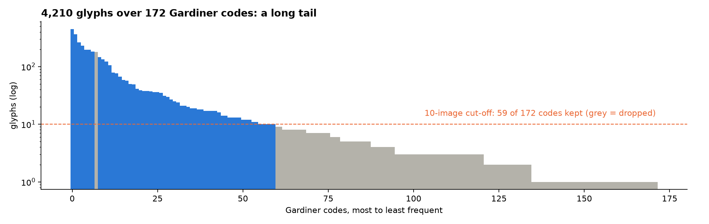

# Hieroglyph classifier: reading Egyptian signs by Gardiner code

A convolutional network that takes a photographed hieroglyph and names it by its [Gardiner sign code](https://en.wikipedia.org/wiki/Gardiner%27s_sign_list) (M17 the reed, N35 the water ripple, G43 the quail chick…). Trained on 3,674 manually labelled glyphs cut from the Pyramid Texts of Unas, it reads **96.9% of test glyphs correctly at the first guess and 99.7% within five guesses**, across the 59 signs that have at least ten examples.

| | |
|---|---|
| Try it | [Hugging Face Space](https://huggingface.co/spaces/omaressamrme/hieroglyph-classifier): drop in a glyph crop, get the top five codes |
| Model | [omaressamrme/hieroglyph-classifier](https://huggingface.co/omaressamrme/hieroglyph-classifier) (Keras, 2.1 M parameters, 8 MB) |
| Training notebook on Kaggle | [hieroglyph-classifier-97-on-59-gardiner-signs](https://www.kaggle.com/code/engomaressam/hieroglyph-classifier-97-on-59-gardiner-signs) |
| Data | [GlyphDataset](https://github.com/morrisfranken/glyphreader) (Franken & van Gemert, ACM Multimedia 2013, MIT): 4,210 glyphs, 50×75 px, from ten photographs of the Unas pyramid texts; Kaggle mirror `ahmedsamir1598/glyphdataset` |



## Results (held-out 20% of glyphs, stratified)

| Metric | Value |
|---|---|
| Top-1 accuracy | **96.9%** |
| Top-5 accuracy | 99.7% |
| Macro F1 | 0.939 |
| Signs | 59 (of 172 in the dataset; those with ≥ 10 glyphs, `UNKNOWN` excluded) |
| Train / validation / test glyphs | 2,571 / 368 / 735 |
| Training | 54 epochs, best at 34, 14 minutes on CPU |

With a confidence gate at 0.95 the model answers 90% of glyphs on its own at 99.5% accuracy and leaves the rest to a person, which is how it would be used on a real wall.



The rare signs are the weak ones: every sign with F1 below 0.8 has fewer than 20 training glyphs. More photographs, not a bigger network, is what would move the number.

## The two training runs, because the first one failed

`train.py` (run 1): three conv blocks, global average pooling, full inverse-frequency class weights (a 10-glyph sign weighed 29× a 290-glyph one), heavy augmentation. It overfitted badly: 71% on training glyphs, under 50% on validation, falling as it trained.

`train_v2.py` (run 2, the published model): a **Flatten** head instead of global pooling (where a stroke sits inside a 50×75 crop is part of the sign), **square-root-damped class weights**, lighter augmentation with white fill (the glyphs sit on light stone), BatchNorm after the dense layer, label-free early stopping on validation accuracy with a long patience. Same data, split and seed, so the comparison is fair. `results/training_history.csv` has both curves' numbers.



## Reproduce

```bash
pip install -r requirements.txt
# get the data: github.com/morrisfranken/glyphreader (or kaggle datasets download ahmedsamir1598/glyphdataset)
python train_v2.py path/to/Dataset/Manual/Preprocessed --min-images 10
python make_figures.py path/to/Dataset/Manual/Preprocessed
```

The model file is not in this repo; it is on Hugging Face, and `labels.json` here maps output indices to Gardiner codes.

## Limitations

The training photographs come from one monument, carved in one style and lit one way; a glyph from a painted tomb or a papyrus will look different. The classifier names single, already-cropped signs: it does not find signs in a wall photograph (that is a detection problem) and it does not translate. Signs with fewer than ten examples are not covered at all.

## Author

Omar Essam El Sherbiny: [website](https://omaressam.web.app) · [LinkedIn](https://www.linkedin.com/in/omar-essam-el-sherbiny-b602279b/)

Dataset citation: M. Franken and J. C. van Gemert, "Automatic Egyptian Hieroglyph Recognition by Retrieving Images as Texts", *ACM Multimedia*, 2013.
